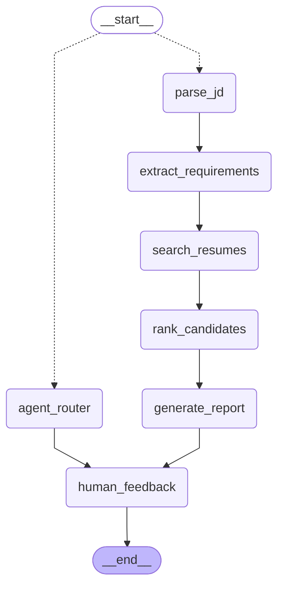

# Agent State Machine

This diagram is generated directly from the compiled LangGraph `StateGraph`, not hand-drawn. The graph has two regimes: a **fixed pipeline** (`parse_jd` through `generate_report`) that runs once per new/replaced job description, and a conversational **router loop** (`agent_router`) that handles every follow-up chat turn by calling tools (compare, explain, re-rank, interview questions, final recommendation) without re-running the pipeline. Both paths converge at `human_feedback`, which simply marks the end of a turn — each chat message is one `graph.invoke()` against a SQLite-checkpointed thread, which is how conversation state persists across turns.

